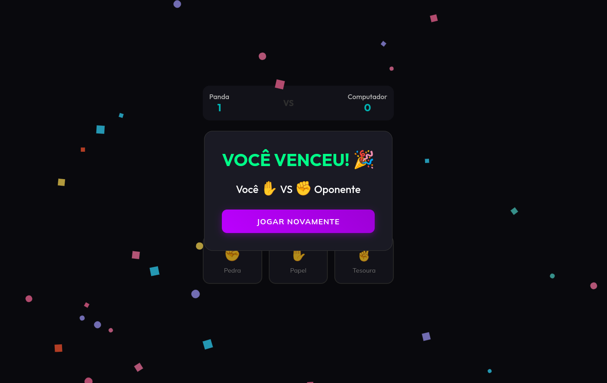

# Neon Jokenpo ✊✋✌️

A modern, real-time Rock-Paper-Scissors game that runs entirely in the browser using Peer-to-Peer (WebRTC) technology.

**Play now**: [https://satodu.github.io/Jokenpo/](https://satodu.github.io/Jokenpo/)

## Features
- **PvC Mode**: Play against the computer immediately.
- **PvP Mode**: Play against a friend in real-time.
    - **Serverless**: Connects directly via PeerJS. No backend server required!
    - **Shareable Links**: Generate a unique link and send it to your friend to join your game instantly.
- **Neon UI**: Modern dark theme with neon animations.
- **Celebrations**: Confetti party on victory! 🎉

## How to Get Your Own Copy (Fork)
Want to host your own version of the game?

1.  Click the **Fork** button at the top right of this repository.
2.  Once forked to your account, go to **Settings** > **Pages**.
3.  Under **Source**, select `Deploy from a branch`.
4.  Select `main` (or `master`) branch and `/` (root) folder.
5.  Click **Save**.
6.  Your game will be live at `https://<your-username>.github.io/Jokenpo/`.

## How to Play
1.  **Enter your Name**.
2.  **Select Mode**:
    - **Vs Computador**: Solo play.
    - **Vs Jogador**: 
        - You become the **Host**.
        - Copy the "Convide um amigo" link.
        - Send it to a friend.
        - When they open it, they will automatically join your session.
3.  **Battle**: Choose your move and see who wins!

## Credits
- Built with [PeerJS](https://peerjs.com/) for P2P networking.
- Confetti by [Wowify.js](https://github.com/satodu/Wowify.js).
- Made by [Panda](https://github.com/satodu).